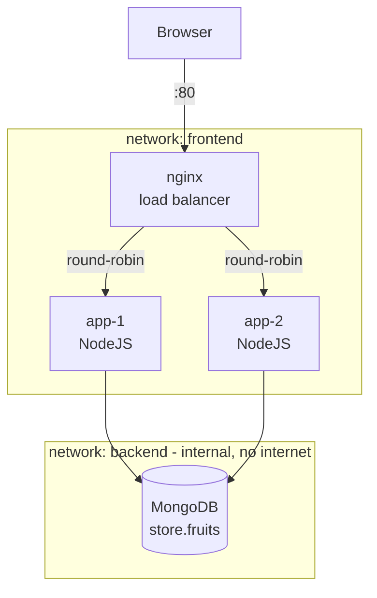
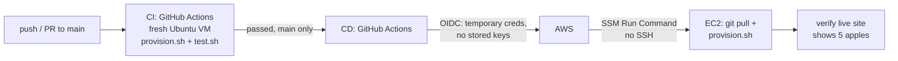
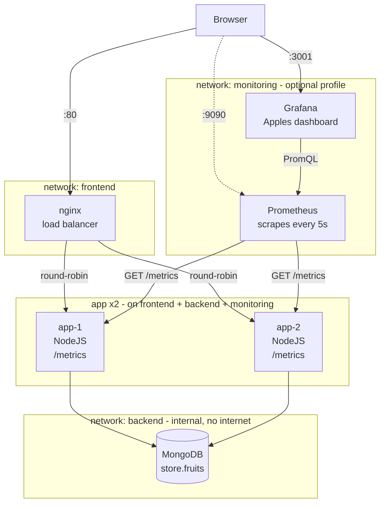

# Apples 🍎

[](https://github.com/ilaycohen12/apples/actions/workflows/ci.yml)
[](https://github.com/ilaycohen12/apples/actions/workflows/cd.yml)

A "Hello World" web app that shows the number of apples stored in MongoDB.
**NodeJS + MongoDB + Docker containers**, fully defined as code and provisioned from scratch with one command.

- **Run locally:** `./scripts/provision.sh` → http://localhost
- **Live on AWS (bonus):** http://52.86.90.227

## Quick start
Requirements: Linux (or Windows WSL2 / macOS) with **Docker Engine + Docker Compose v2**, `git`, `curl`.
```bash
git clone https://github.com/ilaycohen12/apples.git
cd apples
./scripts/provision.sh           # build & start everything from scratch
./scripts/test.sh                # run the tests
./scripts/show-architecture.sh   # live view of containers & network topology
./scripts/destroy.sh             # remove everything
```
Open http://localhost. Port 80 busy? `HTTP_PORT=8080 ./scripts/provision.sh` (same for `test.sh`).

## Architecture



| Component | Image | Role | Networks | Exposed port |
|---|---|---|---|---|
| nginx | `nginx:1.27-alpine` (official) | Load balancer, single entry point | frontend | **80** (only one) |
| app ×2 | `apples-app` (built from `app/Dockerfile`) | Express server, reads apples qty from DB on every request | frontend + backend | none |
| mongo | `mongo:7` (official) | Database, seeded on first start | backend | none |

**Request flow:** Browser → nginx:80 → one of the app containers (round-robin) → MongoDB → HTML page with the apples count.

### Project structure
```
apples/
├── app/
│   ├── server.js              # Express web server: builds the page with the apples count from MongoDB + /health
│   ├── package.json           # App metadata and dependencies (express, mongodb driver)
│   ├── package-lock.json      # Exact dependency versions for reproducible builds
│   ├── Dockerfile             # Builds the app image (node:22-alpine, non-root user, healthcheck)
│   └── .dockerignore          # Keeps node_modules and junk out of the Docker build
├── db/
│   └── seed.js                # Inserts the 4 required fruits on MongoDB's first start
├── nginx/
│   └── nginx.conf             # Load balancer: round-robin to the app replicas, single entry point on port 80
├── docker-compose.yml         # The whole local architecture: 3 services, 2 networks, 1 volume, start order
├── scripts/
│   ├── provision.sh           # Removes any previous deployment and builds everything from scratch until healthy
│   ├── test.sh                # Automated tests: health, apples count, load balancing, topology, isolation
│   ├── show-architecture.sh   # Prints the live containers, networks, IPs and a topology diagram
│   ├── destroy.sh             # Removes containers, networks, the DB volume and the app image
│   ├── aws-up.sh              # Creates the AWS environment with Terraform and connects GitHub CD
│   └── aws-down.sh            # Deletes the AWS environment and disconnects GitHub CD
├── infra/terraform/
│   ├── versions.tf            # Terraform + AWS provider versions and default tags
│   ├── variables.tf           # Settings with defaults (region, instance size, repo, branch...)
│   ├── main.tf                # EC2 server, security group (port 80 only) and Elastic IP
│   ├── iam.tf                 # Server role for SSM + GitHub OIDC role for CD (least privilege)
│   ├── outputs.tf             # Prints the public IP, URL, instance ID and CD role ARN
│   ├── user-data.sh           # Server first boot: installs Docker, clones this repo, runs provision.sh
│   └── .terraform.lock.hcl    # Locks the exact AWS provider version
├── .github/workflows/
│   ├── ci.yml                 # CI: provision + test on a fresh Ubuntu VM for every push/PR
│   └── cd.yml                 # CD: after CI passes on main, deploys to EC2 via SSM and verifies the live site
├── REQUIREMENTS.md            # The original exercise
└── README.md                  # This file
```

## Scripts
| Script | What it does |
|---|---|
| `provision.sh` | Checks prerequisites, removes any previous deployment (incl. DB volume), builds and starts all containers, waits until all are healthy |
| `test.sh` | Automated tests (below). Exit code 0 = all passed |
| `show-architecture.sh` | Reads the **live** state from Docker and prints containers, networks, IPs and a topology diagram |
| `destroy.sh` | Removes containers, networks, DB volume and the built app image |
| `aws-up.sh` / `aws-down.sh` | Bonus: create / delete the AWS environment (see below) |

## Tests
| # | Test | Requirement |
|---|---|---|
| 1 | All 4 containers are running and healthy | Provision from scratch |
| 2 | The page shows the apples count, equal to the value in the DB (5) | Page returns number of apples in the DB |
| 3 | Requests are served by 2 different app containers | Load balancer |
| 4 | nginx only on frontend, mongo only on backend, app on both | Network topology |
| 5 | Only nginx exposes a port | Network topology / security |
| 6 | nginx cannot reach MongoDB | Network topology / security |

The visual demonstration is `./scripts/show-architecture.sh` (live) + the diagram above.

## Bonus

### Load balancer
- **nginx** in front of **2 app replicas** (`deploy.replicas: 2`), round-robin. Docker's DNS resolves the service name `app` to both containers.
- nginx is the only published port; the apps have none.
- Visible on the page ("Served by container: ...") and verified by test 3.

### CI/CD



- **CI** (`.github/workflows/ci.yml`): every push/PR runs the same scripts on a clean Ubuntu machine.
- **CD** (`.github/workflows/cd.yml`): after CI passes on `main`, deploys to EC2 and verifies the live site. Skipped automatically if no AWS environment exists.

### AWS environment (Terraform, `infra/terraform/`)
- **EC2** Ubuntu 24.04 `t3.micro` with a fixed **Elastic IP**. On first boot, `user-data.sh` installs Docker, clones this repo and runs the same `provision.sh`.
- **Security Group**: only port 80 open. No SSH.
- **IAM**: server role for SSM; a GitHub OIDC role that only this repo's `main` branch can assume, allowed only to send a command to this one server.

Create / delete (needs `terraform`, `aws`, `gh` and an AWS account with EC2 + IAM permissions):
```bash
AWS_PROFILE=<your-profile> ./scripts/aws-up.sh     # terraform apply + connect GitHub CD
AWS_PROFILE=<your-profile> ./scripts/aws-down.sh   # terraform destroy + disconnect CD
```

### Monitoring (own idea – Pull Request)
Proposed in [PR #9](https://github.com/ilaycohen12/apples/pull/9) (kept open for review, as the exercise asks for own ideas as a PR).

- **Prometheus** scrapes `/metrics` from both app containers every 5s (request count, latency, errors, apples in stock, Node.js memory/CPU).
- **Grafana** shows a ready-made dashboard (provisioned as code), including requests **per container** to visualize the load balancer.
- Optional: `./scripts/provision.sh --monitoring`. Without the flag, nothing changes.
- Isolated: separate `monitoring` network; `/metrics` is not exposed through nginx.

**How to try it** (the monitoring code lives on the PR branch, not on `main`):
```bash
git checkout feature/monitoring        # monitoring files exist only on this branch
./scripts/provision.sh --monitoring    # 6 containers: + Prometheus + Grafana
./scripts/load.sh                      # send traffic so the graphs have data
./scripts/test.sh                      # 15 tests (adds 3 monitoring tests)
```
Open http://localhost:3001 (Grafana, no login) and http://localhost:9090 (Prometheus).
To go back: `git checkout main && ./scripts/provision.sh`.

**Full architecture with monitoring:**


## Design decisions
- **One container per component**; only the app (our code) has a Dockerfile, mongo and nginx use official images.
- **Network isolation**: `backend` is `internal`, so the DB has no internet access and is unreachable from nginx. Only nginx publishes a port.
- **Healthchecks + ordered startup**: mongo → app → nginx (`depends_on: service_healthy`); `provision.sh` waits until everything is healthy.
- **Reproducible**: `package-lock.json` + `npm ci`; every provision starts from an empty DB.
- **One script, three places**: `provision.sh` runs locally, in CI and on EC2.
- **Security**: non-root app container, no SSH, no stored cloud keys (OIDC), least-privilege IAM, IMDSv2.

## Known limitations / production improvements
- MongoDB has no authentication (isolated and not exposed). Production: credentials from a secrets manager, replicated MongoDB.
- nginx resolves app IPs at startup. Production: Kubernetes Service or nginx `resolver`.
- Deploy = re-provision, so ~1-2 min downtime and the DB is reseeded. Production: rolling / blue-green deploy, persistent DB.
- Terraform state is local. Production: S3 backend with versioning + locking, and an infra pipeline (plan on PR, apply on merge).
- Single host. Production: an orchestrator (Kubernetes / ECS).

## Requirements checklist
| Requirement | Where |
|---|---|
| "Hello world" apples page | `app/server.js` |
| NodeJS, MongoDB, Containers | `app/`, `db/`, `docker-compose.yml` |
| Linux runtime | Any Linux with Docker; tested on Ubuntu (CI, EC2, WSL) |
| Each component in its own container | `docker-compose.yml` |
| Fully defined as code (IaC) in GitHub | this repo |
| DB contains the given data | `db/seed.js` |
| Checked by running scripts | `scripts/` |
| Tests: provision / apples count / visual | `provision.sh`, `test.sh`, `show-architecture.sh` |
| Bonus: CI/CD with a cloud provider | `.github/workflows/`, `infra/terraform/` |
| Bonus: README | this file |
| Bonus: Load balancer | `nginx/nginx.conf` + 2 app replicas |
| Bonus: own ideas as a Pull Request | open PRs |

## AI usage
This project was built with the assistance of AI (Claude, by Anthropic).
